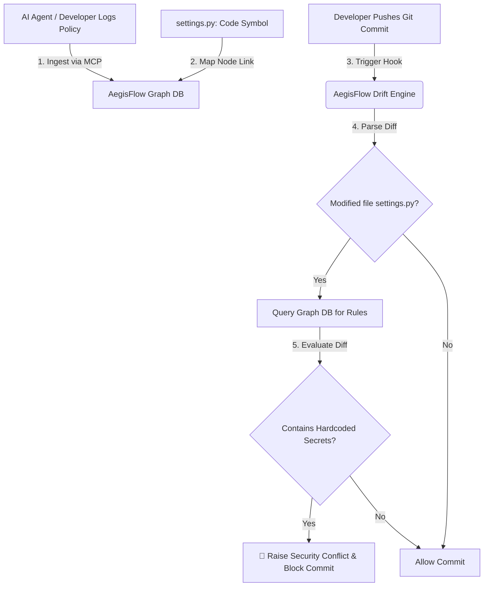

# AegisFlow: Cognitive Project Memory & Security Drift Engine

AegisFlow is a persistent memory layer designed to align coding agents and developers. It links **Architectural & Security Decisions** directly to **Code Symbols** (files, classes) in a **Cognitive Knowledge Graph**, detecting and blocking policy drift at the Git hook level.

This prototype demonstrates AegisFlow's ability to prevent **API Key & Secret Leakage** (the zero-hardcoded secrets policy).

---

## 📊 System Flowchart

### GitHub/Markdown Rendered Flowchart (Mermaid)


### Terminal/CLI Text Flowchart (ASCII)
```
  [Policy Declaration] ─────────┐
                                │ 
                                ▼ (1. Map Relationship)
  [Code File: settings.py] <────┴───────── [AegisFlow Graph DB]
         ▲                                       │
         │ (2. Parses modified file)             │ (3. Checks active rules)
         │                                       ▼
  [Git Commit Push] ───────────────> [AegisFlow Drift Engine]
  (e.g., Hardcoded JWT Secret)                   │
                                                 ▼
                                     [🚨 BLOCKS COMMIT & ALERTS]
```

---

## ⚙️ Methodology

AegisFlow runs on a four-stage lifecycle to ensure code changes match structural and security rules:

### 1. Policy Declaration (Ingestion Phase)
* **What happens:** When developers or AI tools make a structural or security design choice, it is registered in the system (via a terminal command or an MCP tool call).
* **Technical Detail:** The rule is logged into the `decisions` table with a unique identifier, summary, rationale, and metadata tags (e.g., `security`, `payments`).

### 2. Graph Mapping (Linkage Phase)
* **What happens:** AegisFlow links the new decision to the specific parts of the codebase it governs.
* **Technical Detail:** In our SQLite database, we create nodes in `code_symbols` representing target files (e.g., `settings.py`) and write connection edges in the `decision_symbol_links` table.

### 3. Commit Analysis (Detection Phase)
* **What happens:** When code is pushed, AegisFlow intercepts the push (simulating a Git pre-push hook) and scans the unified diff content.
* **Technical Detail:** It extracts filenames changed (lines starting with `+++ b/`). It queries the database to see if these modified files are linked to any active decisions.

### 4. Validation & Action (Prevention Phase)
* **What happens:** The engine analyzes the lines added in the diff (marked with `+`) using regex and keyword rules to check if they violate the intent of the active policies.
* **Technical Detail:** In our demo, the engine detects hardcoded assignments of tokens (`JWT_SECRET = "sk_live_..."`) instead of environment loaders (`os.environ`). If a violation is found, it throws a `COGNITIVE CONFLICT DETECTED` error and aborts the push, protecting the cloud repository.

---

## How to Run the Demo

1. Open a terminal (PowerShell, Command Prompt, or Bash).
2. Navigate to this directory:
   ```cmd
   cd "C:\Users\palli\OneDrive\Desktop\AegisFlow"
   ```
3. Run the interactive control panel:
   ```cmd
   python demo.py
   ```
4. Choose **Option 1** to run the complete, automated security simulation, or step through options **2 to 7** manually to explain the system architecture piece-by-piece.

---

## Presenting AegisFlow to an Interviewer

### 1. The Core Problem (Context Amnesia & Key Leaks)
AI coding tools operate in isolated chat sessions, meaning they have no long-term memory of previous decisions. A common, high-risk result of this is **security credential leakage**. Agents or developers working in a hurry often hardcode JWT secrets or API keys into config files, exposing keys to repository histories and cloud exploits.

### 2. The AegisFlow Solution
Instead of searching flat text files, AegisFlow constructs a directed graph of relationships:
`[Security Policy: Zero Secrets] ───(linked constraint)───> [File: settings.py]`

When a commit contains code changes, AegisFlow parses the Git diff, queries the graph, evaluates the logic, and blocks the commit if a hardcoded secret is detected.

### 3. Key Pitch Highlights
* **High Real-World Impact:** Resolves the massive cloud vulnerability risk of committed credentials.
* **Lightweight Graphing:** Lowers query overhead by using metadata relationships instead of vector database scans on full codebases.
